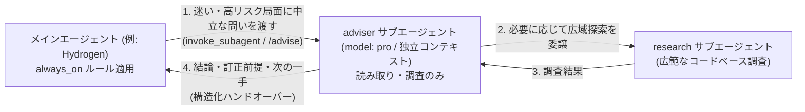

# agy-adviser-plugin

Google Antigravity 向けの汎用セカンドオピニオン・アドバイザープラグインです。  
普段の実行セッションには高速・低コストなモデル（例: **Gemini 4 Hydrogen**）を使いつつ、判断に迷う局面やリスクの高い意思決定だけを**完全にコンテキストを分離した `adviser` サブエージェント（`model: pro` / 例: Gemini 4 Argon・Carbon 等）**へ委譲することで、**コスト効率**と**高度な推論・客観性**を両立します。

---

## 目的と解決したい課題

### 1. コスト効率と知能のバランス最適化
すべての調査・編集・定型作業を高知能モデルで回すとトークンコストが膨らみます。逆に軽量・高速モデルだけで複雑な設計判断や難解なデバッグを行うと、判断ミスや手戻りが増えます。  
本プラグインでは役割を分離します。

- **メインエージェント（例: Hydrogen）**: コード編集、通常タスクの実行、コンテキスト維持を担当
- **`adviser` サブエージェント（`model: pro`）**: 設計分岐、難解なバグの原因切り分け、高リスク変更のレビューなど「判断の質が効く場面」だけを担当

### 2. 同一セッション特有の「過信・確証バイアス」の排除
AI エージェントは同一セッション内で対話や試行を重ねるほど、**直前の自分の発言や仮説に対して過度な自信（確証バイアス / アンカリング）を持ちやすい**傾向があります。  
`adviser` を別コンテキストのサブエージェントとして起動し、さらに **「呼び出し元（メインエージェント）が渡した要約や仮説は間違っているかもしれない」** というゼロトラスト前提で検証させることで、バイアスのないセカンドオピニオンを得られます。

---

## アーキテクチャ



### 設計上のポイント

1. **トピック単位の完全コンテキスト分離と再帰防止**  
   新しい相談ごとに新規 `invoke_subagent` で `adviser` を起動し、過去の判断への引きずりを防ぎます（同一論点の深掘り時のみ `send_message` を使用）。また `rules/AGENTS.md` はメインエージェントのみに適用するよう明記し、`adviser` 自身による再帰呼び出しを防いでいます。
2. **ゼロトラスト検証 + 読み取り専用権限**  
   `adviser` には編集ツール（`edit_file` / `write_file`）を与えず、`read_file`・読み取り専用の `run_command`・`search_web` のみを許可します。さらに内部で `research` サブエージェントを呼び出してコードベースを裏取りできるため、`pro` モデルのコンテキストを肥大化させずに事実確認を行えます。
3. **過剰呼び出しを防ぐ明確なトリガー設計**  
   `always_on` ルールで「呼ぶべき局面」と「呼ばなくてよい軽微な作業」を切り分け、無駄な上位モデル消費を抑えます。
4. **委譲元が迷わず実行できる構造化ハンドオーバー**  
   コスト削減の本質は「通常作業を軽量モデルで回し、要所だけ `adviser` を呼ぶこと」にあるため、`adviser` の出力はトークンを過度に削らず、以下の4セクションで明確に引き継ぎます。
   - **Decision / Verdict**: 曖昧さを排した結論・採用方針
   - **Verified Facts & Corrected Assumptions**: 裏取りした事実（ファイル・行番号）と、委譲元の誤った前提・仮説の明示的な訂正
   - **Rationale & Risk Guardrails**: 判断理由、代替案を退けた根拠、実装時の注意点・エッジケース
   - **Concrete Next Steps**: 委譲元が推測せずにそのまま実行できる具体的な手順

---

## 同梱コンポーネント

```text
agy-adviser-plugin/
├── plugin.json               # プラグインマニフェスト
├── rules/
│   └── AGENTS.md             # プラグイン有効時に常時適用（always_on）される委譲ルール
├── agents/
│   └── adviser.md            # pro ティアで動作する読み取り専用アドバイザー定義
├── skills/
│   └── advise/
│       └── SKILL.md          # 明示的呼び出し用 /advise スキル
└── README.md                 # 本ドキュメント
```

| ファイル | 役割 |
| :--- | :--- |
| [plugin.json](./plugin.json) | プラグインメタデータ（`name: "agy-adviser"`）および初期プロンプト例 |
| [rules/AGENTS.md](./rules/AGENTS.md) | プラグイン有効時に自動で読み込まれ、委譲トリガー・コスト抑制基準・中立な依頼方法をメインエージェントに指示 |
| [agents/adviser.md](./agents/adviser.md) | `model: pro`・読み取り/調査専用ツール・`research` 連携・ゼロトラスト姿勢を定義したカスタムサブエージェント |
| [skills/advise/SKILL.md](./skills/advise/SKILL.md) | ユーザーが `/advise` やセカンドオピニオンを明示的に指示した際の手順を提供するスキル |

---

## 主なユースケース

1. **設計・アーキテクチャの分岐での相談**  
   API 境界、データモデル、状態管理、ライブラリ選定など、後から覆しにくい選択肢を比較したいとき。
2. **同じエラー・修正の 2 回連続失敗（ハマり防止）**  
   メインエージェントが同じ仮説に固執して修正ループに入りかけたとき、別コンテキストから根本原因を再検証する。
3. **高リスク・破壊的変更・セキュリティ影響の事前チェック**  
   DB マイグレーション、認証・認可、権限周り、公開インターフェース破壊などの前に見落としリスクを洗い出す。
4. **仕様の曖昧さ・コード規約との矛盾の整理**  
   要件や既存実装の意図が読み取りにくく、前提の置き方に迷うとき。
5. **`/advise` によるユーザー起点のセカンドオピニオン取得**  
   自動トリガーを待たず、ユーザーが「ここだけ上位モデルの視点で一度レビューしてほしい」と感じたタイミングで明示的に呼び出す。

---

## インストールと検証

### 前提
Google Antigravity（`agy` CLI または Antigravity App）が利用可能であること。

### 検証（開発・カスタマイズ時）

```bash
agy plugin validate --strict .
```

### インストール

ローカルディレクトリからインストールする場合:

```bash
agy plugin install ./agy-adviser-plugin
agy plugin list
```

GitHub リポジトリから直接インストールする場合（公開後）:

```bash
agy plugin install <your-github-repo-url>
```

> [!NOTE]
> プラグインを有効化すると、`rules/AGENTS.md` はプラグインが有効な間 **常時適用（`always_on`）** になり、`adviser` サブエージェントと `/advise` スキルがセッションから利用可能になります。

---

## カスタマイズ例

### 使用するモデルを変更する
汎用性を優先して [agents/adviser.md](./agents/adviser.md) では `model: pro` を指定しています。環境やアカウントで利用可能な特定モデル（例: Argon / Carbon など）へ明示的に固定したい場合は、`agents/adviser.md` のフロントマターを編集してください。

```yaml
model: pro # 環境に応じて利用したいモデル指定へ変更可能
```

### 委譲の厳格さを調整する
プロジェクトのコスト方針や品質要件に応じて、[rules/AGENTS.md](./rules/AGENTS.md) の「When to Consult `adviser`」やスキップ条件（`Skip adviser for ...`）を編集して運用できます。
